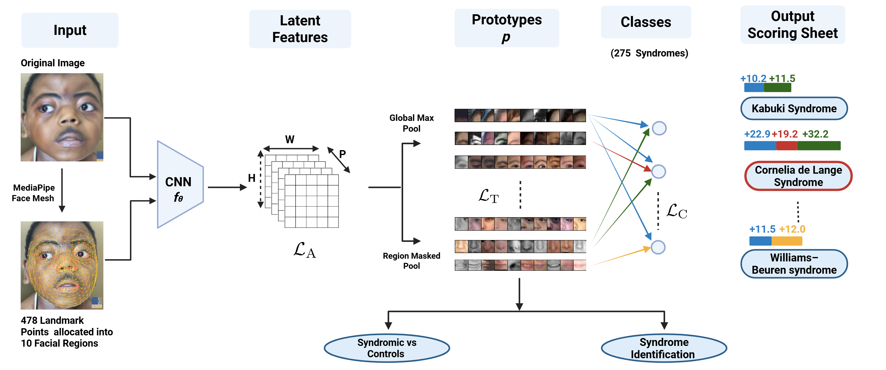
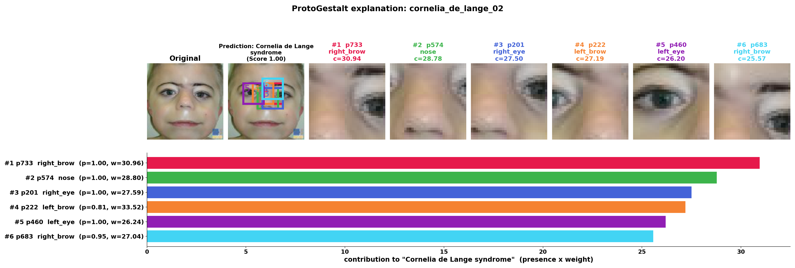

# ProtoGestalt

**Interpretable facial dysmorphology recognition with region-anchored part-prototypes.**

ProtoGestalt extends [PIP-Net](https://github.com/M-Nauta/PIPNet) (Nauta *et al.*, CVPR 2023)
to next-generation phenotyping on the [GestaltMatcher Database (GMDB)](https://db.gestaltmatcher.org/).
It keeps PIP-Net's self-supervised, part-prototype design — an image is represented by *which
learned facial-part prototypes are present* — and adds face-specific structure so the prototypes
are anatomically meaningful and the model can be evaluated the way clinical phenotyping tools are.

<p align="center">
  <br>
  <em><b>ProtoGestalt overview.</b> An input face is landmarked with MediaPipe Face Mesh
  (478 points grouped into 10 facial regions) and encoded by a CNN backbone into an H×W grid of
  P prototype-presence maps. Prototypes are pooled either globally (vanilla PIP-Net) or only
  within their assigned facial region (region-masked pooling), and a sparse non-negative linear
  layer scores them against the 275 GMDB syndromes to produce a per-syndrome prototype scoring
  sheet. Training combines the alignment (L<sub>A</sub>), tanh (L<sub>T</sub>), and classification
  (L<sub>C</sub>) losses. The same prototype representation supports both syndrome identification
  and syndromic-vs-control screening.</em>
</p>

Key additions over vanilla PIP-Net:

- **Region-masked pooling** (`--masked_pool`): each prototype is confined to one MediaPipe
  landmark region (eyes, brows, nose, mouth, cheeks, chin, forehead), so it can only contribute
  from inside its facial region.
- **Prototype-localization loss** (`--loc_loss`): a soft training penalty that anchors each
  prototype's spatial activation inside its assigned region.
- **Cross-dataset prototype pretraining** on CASIA-WebFace (`--pretrain_data_dir`).
- **GestaltMatcher-protocol evaluation and interpretability tools** (see *Evaluation* below).

This repository is a research fork of PIP-Net; the core prototype learning lives in the
`pipnet/` package and retains its original design and attribution.

---

## Installation

```bash
conda create -n protogestalt python=3.9
conda activate protogestalt
pip install torch torchvision numpy pandas scikit-learn matplotlib scipy pillow tqdm mediapipe
```

> **Paths.** Scripts default to the original author's directory layout (e.g.
> `/data2/masino_lab/abamini/...`, `/home/abamini/GMDB_data/...`). Override them with the CLI
> flags shown below (`--dataset`, `--model_dir`, `--freq_root`, `--meta_dir`, `--landmarks_dir`,
> `--output_dir`, …) or edit the `DEFAULT_*` constants at the top of each script for your setup.

## Data

> **GMDB is a closed dataset.** It contains identifiable medical facial images of patients with
> rare genetic disorders, so — for privacy and ethical reasons — it is not publicly downloadable.
> Access is granted on request to the maintainers via the GestaltMatcher Database portal:
> <https://db.gestaltmatcher.org/>. This repository ships only code and the split metadata; you
> must obtain the images yourself.

- **GMDB** — frequent (seen) and rare (unseen) splits, resolved from the official GMDB metadata
  CSVs (`gmdb_metadata/`). Aligned 112×112 face crops.
- **MediaPipe landmarks** — one `<id>_aligned_landmarks.txt` per image (478 points), used for
  region-masked pooling and the localization loss. Generate crops + landmarks with
  `crop_align.py` (RetinaFace detector → ArcFace 5-point alignment).
- **Normal-face datasets** (for the screening experiment) — CASIA-WebFace and UTKFace, aligned
  the same way.

### Generating landmarks

`util/mediapipe_pixle_generator.py` produces the per-image landmark files with **MediaPipe Face
Mesh** (`refine_landmarks=True` → 478 points). For every image it writes a
`<name>_landmarks.txt` whose lines are `index,pixel_x,pixel_y` (the format `util/data.py`
expects, normalized by `--landmark_img_size` at load time), plus an optional annotated preview.

```bash
pip install opencv-python mediapipe
# set IMAGE_DIR / LANDMARK_SAVE_DIR at the top of the script, then:
python util/mediapipe_pixle_generator.py
```

Run it on the **aligned** crops so the landmark coordinates match the images fed to the model.

## Training

Two stages: self-supervised prototype pretraining, then classification.

```bash
python main.py --dataset gmdb \
  --net convnext_tiny_26 --image_size 112 \
  --masked_pool --mask_radius 0.1 \
  --batch_size 64 --epochs_pretrain 5 --epochs 80 \
  --log_dir ./runs/protogestalt
```

Useful flags:

| flag | purpose |
|---|---|
| `--masked_pool` / `--mask_radius` | region-masked pooling and its region-disk radius |
| `--loc_loss` / `--loc_weight` / `--loc_temp` | prototype-localization loss |
| `--net` | backbone: `convnext_tiny_26/13`, `resnet18/34/50/101/152`, `iresnet100`, `iresnet100_arcgmdb` |
| `--num_features` | number of prototypes (set >0 for ArcFace backbones; adds a 1×1 add-on conv) |
| `--pretrain_data_dir` / `--pretrain_landmarks_dir` | CASIA (or other) corpus for Stage-1 prototype pretraining |
| `--weighted_loss` | class-balanced loss (recommended for the imbalanced binary task) |
| `--gallery_validation` | run GestaltMatcher retrieval on the trained model in-process |
| `--post_validation gallery,binary,syndrome` | run the standalone eval scripts after training |

Checkpoints and logs are written to `--log_dir` (`checkpoints/net_trained`, `metadata/args.pickle`,
`out.txt`, `tqdm.txt`, prototype visualizations).

## Evaluation & interpretability

All scripts load a finished run via `--model_dir <log_dir>` (which must contain
`metadata/args.pickle` and `checkpoints/net_trained`).

| script | what it does |
|---|---|
| `gallery_validation.py` | GestaltMatcher retrieval (kNN / nearest-class-mean) top-k on GMDB-frequent (single split) and GMDB-rare (10-fold CV). Options: TTA, CSLS hubness correction, class-aggregation, a supervised-contrastive projection head, and comparison against external (Hustinx 2023) embeddings. |
| `syndrome_prediction.py` | Uses the trained **classifier head** for frequent (seen) syndromes and **retrieval** for rare (unseen) — the right tool per split. Reports top-1/5/10. |
| `binary_validation.py` | Syndromic-vs-normal screening: a logistic probe on prototype vectors (GMDB positives vs CASIA/UTKFace normals), with test-prevalence sweeps and a **dataset-identity confound probe**. |
| `explain_prediction.py` | Local explanation for one image: the top prototypes driving the prediction, their contribution (presence × class weight), patches, regions, and heatmaps. |
| `prototype_consistency.py` | Do the same prototypes drive a syndrome across patients? Per-patient decision/activation signatures and their overlap. |
| `prototype_purity.py` | Top-K exemplar **region purity** of prototypes, comparing region-masked vs vanilla models against a region-prevalence null. |
| `convert_arcgmdb_backbone.py` | One-time converter that turns a GMDB-adapted ArcFace ONNX/`.pth` into a `--net iresnet100_arcgmdb` backbone. |

Example:

```bash
python gallery_validation.py   --model_dir ./runs/protogestalt --tta hflip --class_aggregate mean
python syndrome_prediction.py  --model_dir ./runs/protogestalt
python explain_prediction.py   --model_dir ./runs/protogestalt --image path/to/face.jpg --topk 6
```

<p align="center">
  <br>
  <em><b>Local explanation (<code>explain_prediction.py</code>).</b> For a case predicted as
  Cornelia de Lange syndrome, the top-6 prototypes driving the decision are shown with their
  contribution (presence × class weight); each patch marks where the prototype activates most
  strongly on this image (boxed on the face), and the bar chart ranks the contributions. The
  evidence concentrates on the eyebrows, eyes, and nose — features clinically relevant to
  Cornelia de Lange syndrome.</em>
</p>

## Repository layout

```
main.py                     training pipeline (2-stage) + post-training validation hooks
pipnet/                     core PIP-Net: model (pipnet.py), losses & training (train.py), eval (test.py)
features/                   backbones (ResNet, ConvNeXt, IResNet/ArcFace, ArcFace-GMDB)
util/                       data loading, args, visualization, landmark generation (mediapipe_pixle_generator.py)
gmdb_common.py              shared GMDB+PIP-Net helpers (model loading, embedding) used by all eval scripts
gallery_validation.py       GestaltMatcher retrieval evaluation
syndrome_prediction.py      classifier (frequent) + retrieval (rare)
binary_validation.py        syndromic-vs-normal screening + confound probes
explain_prediction.py       single-image prototype explanation
prototype_consistency.py    cross-patient prototype consistency
prototype_purity.py         region purity (masked vs vanilla)
crop_align.py               face detection + alignment (RetinaFace -> ArcFace template)
tune.py                     Optuna hyperparameter search
```

## Acknowledgements

Built on **PIP-Net** — M. Nauta, J. Schlötterer, M. van Keulen, C. Seifert,
*"PIP-Net: Patch-Based Intuitive Prototypes for Interpretable Image Classification"*, CVPR 2023
([code](https://github.com/M-Nauta/PIPNet)). Evaluation follows the **GestaltMatcher** protocol
(Hsieh *et al.* 2022; Hustinx *et al.* 2023) on the **GestaltMatcher Database (GMDB)**.
